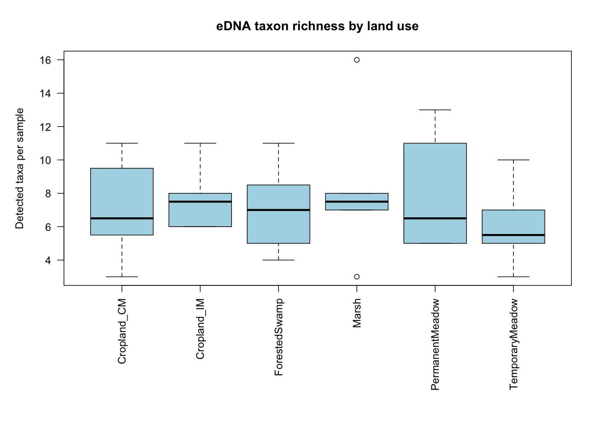
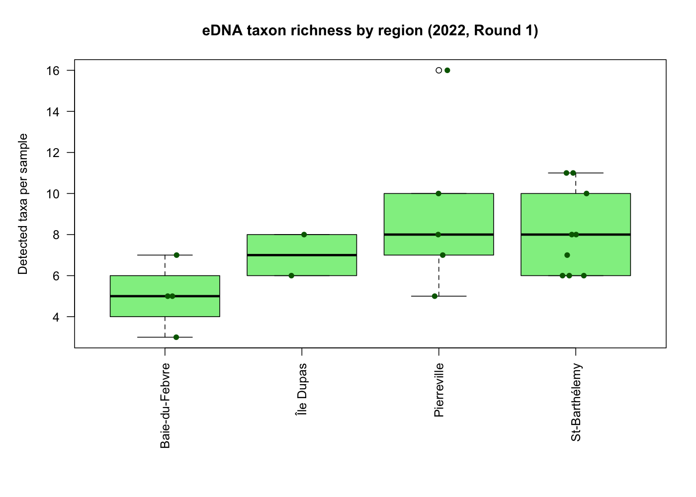
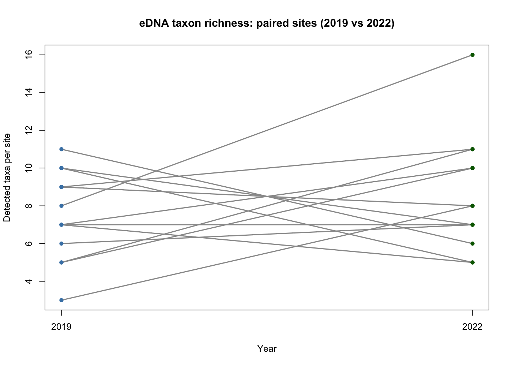

# Freshwater eDNA Biodiversity

## Project overview

This project explores freshwater biodiversity using environmental DNA (eDNA) data from a publicly available research dataset.

The analyses investigate variation in detected taxon richness across land-use categories, geographic regions, and sampling years.

## Dataset

- **Source:** [Dryad dataset](https://doi.org/10.5061/dryad.3bk3j9kzf)
- **Records:** 1,692
- **Sampling sites:** 29
- **Distinct biological codes:** 36
- **Regions:** Baie-du-Febvre, St-Barthélemy, Île Dupas, and Pierreville
- **Sampling years:** 2019 and 2022

The original dataset is stored in `data/edna_lg_clean.csv`.

## Methods

Taxon richness was calculated as the number of biological codes with a positive `count` value within each site, year, and sampling round.

Three exploratory analyses were performed:

1. **Land-use comparison:** distribution of detected taxon richness across six land-use categories.
2. **Regional comparison:** taxon richness across four regions, restricted to the first sampling round of 2022.
3. **Temporal comparison:** paired comparison of 13 sites sampled in both 2019 and 2022 during ROUND1.

The temporal comparison was evaluated using a paired Wilcoxon signed-rank test.

## Key findings

- Across 47 sampling units, detected taxon richness ranged from **3 to 16**, with a mean of approximately **7.30 taxa**.
- Taxon richness varied among sampling sites and land-use categories.
- Regional differences were explored using 20 samples from 2022, ROUND1.
- Among 13 sites sampled in both years, 7 showed increased richness, 5 decreased richness, and 1 remained unchanged.
- The paired Wilcoxon test did not detect a statistically significant difference between 2019 and 2022 (**V = 50.5, p = 0.3858**).

## Figures

### Taxon richness by land use

### Taxon richness by region

### Paired richness comparison, 2019–2022

## Reproducibility

The analyses use base R and can be reproduced by running the following scripts from the project directory, in order:

- `01_taxon_richness.R`
- `02_taxon_richness_by_region.R`
- `03_paired_richness_2019_2022.R`

The scripts generate figures in `outputs/figures/` and a results table in `outputs/tables/`.

## Scientific limitations

Detected eDNA taxon richness is not necessarily equivalent to total species richness or fish abundance.

Differences in environmental conditions, sampling effort, detection probability, and study design may affect the results. The regional and land-use comparisons are exploratory and do not establish causal relationships.

The paired temporal comparison includes only 13 sites, so the absence of a statistically significant difference should not be interpreted as proof of no ecological change.

## Data attribution

Original data are attributed to the authors of the Dryad dataset associated with DOI [10.5061/dryad.3bk3j9kzf](https://doi.org/10.5061/dryad.3bk3j9kzf). Consult the dataset record for the full citation and applicable reuse conditions.